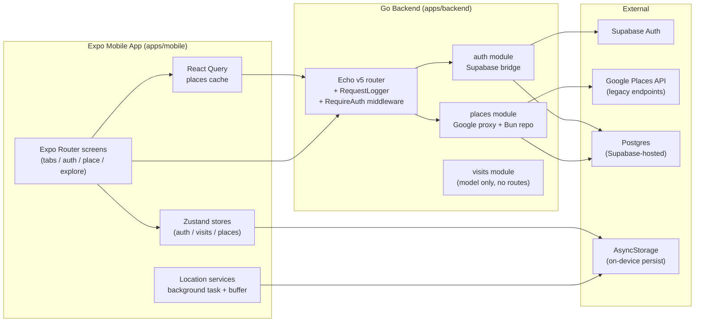
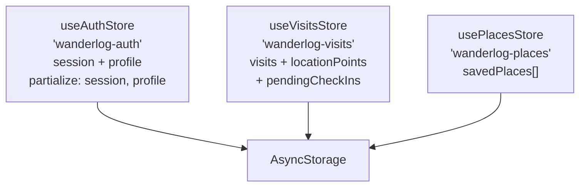
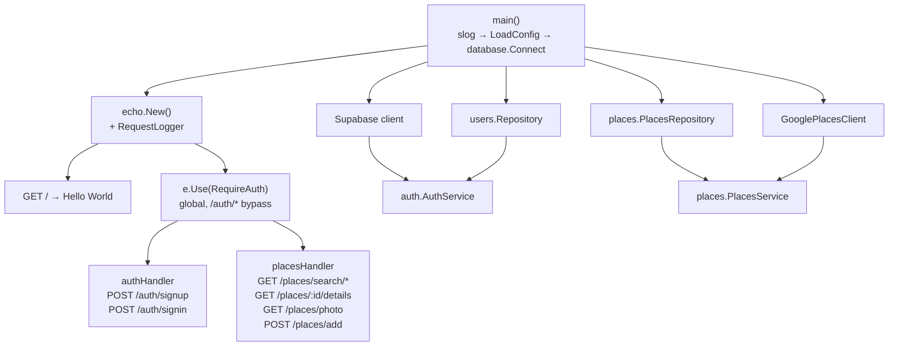
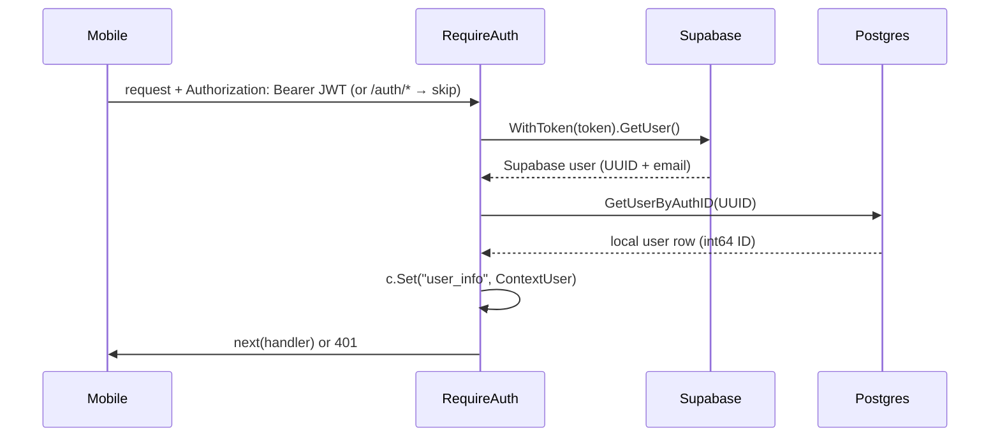
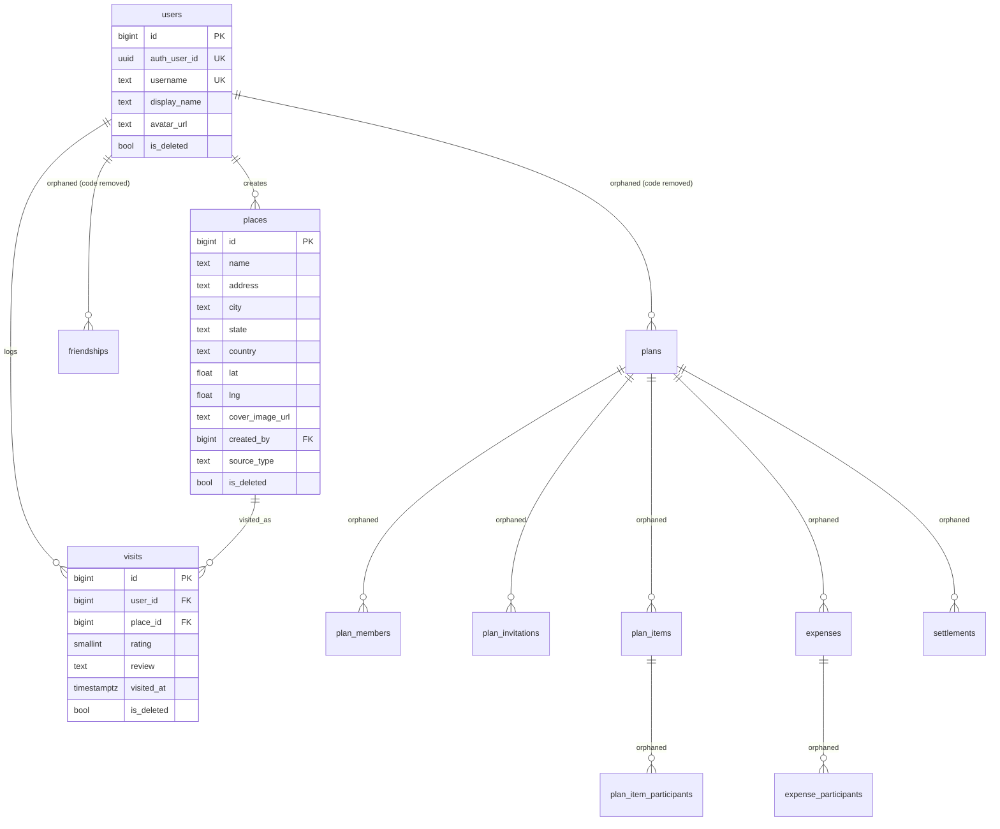
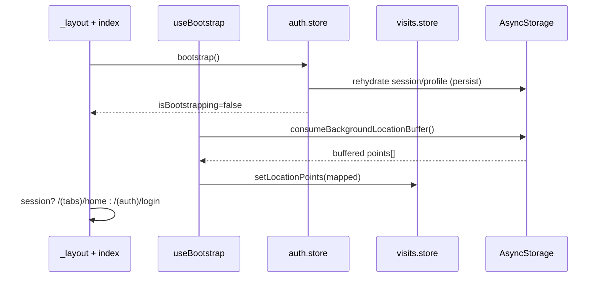
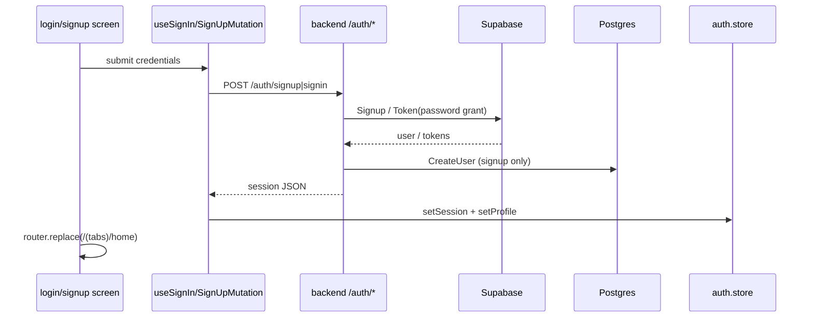
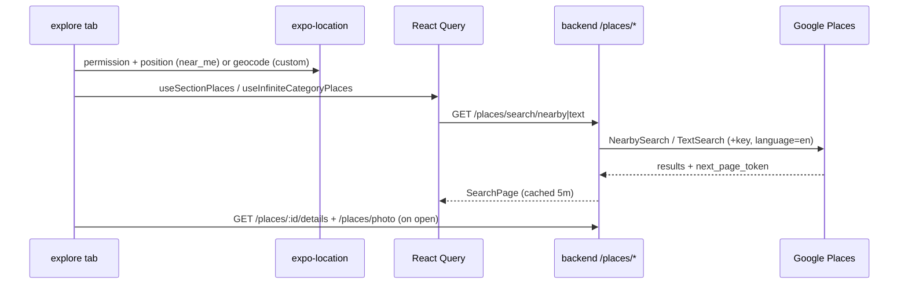
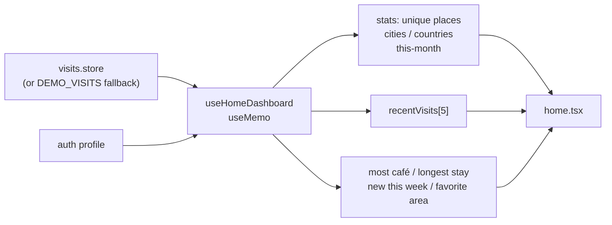

# WanderLog — Current Architecture

> Comprehensive reference of the codebase as it stands today: monorepo layout, mobile app, backend API, data models, code flows, and known gaps. Written to support planning the restaurant-logging (AniList-style) pivot.
>
> Status notes: `internal/plans` Go module, `Friendship` model, and the mobile plans UI/API were removed; SQL migrations `00002`/`00003` still exist (orphaned history).

---

## 1. System Overview



### 1.1 Repository layout

```text
wanderlog/
├── apps/
│   ├── mobile/                 # Expo SDK 56 app (@wanderlog/mobile)
│   │   ├── app.json / eas.json
│   │   └── src/
│   │       ├── app/            # Expo Router routes
│   │       ├── components/     # home / explore / wanderlog (shared)
│   │       ├── stores/         # zustand + persist
│   │       ├── services/api/   # auth / places / visits fetchers
│   │       ├── services/location/
│   │       ├── hooks/          # bootstrap / auth mutations / places / dashboard / sync
│   │       ├── models/         # auth + profile shapes
│   │       ├── types/          # domain + places
│   │       ├── constants/      # api / features / places / home demo / theme / colors
│   │       ├── lib/            # react-query client
│   │       └── utils/          # id + place actions
│   ├── backend/                # Go HTTP API (module github.com/Hacktastic-Labs/wanderlog)
│   │   ├── server.go           # entrypoint + wiring
│   │   └── internal/
│   │       ├── auth/           # handler / service / middleware / context / supabase / types
│   │       ├── users/          # model + repository (service.go is empty stub)
│   │       ├── places/         # handler / service / repository / model / requests / search / google / errors
│   │       ├── visits/         # model.go only (handler/service are empty stubs)
│   │       ├── config/         # koanf env loader + validation
│   │       └── database/       # bun conn + goose migrations 00001-00003
├── prototype/
│   └── index.html              # 12-screen HTML mock (welcome/login/signup/home/plans/invite/balances/drafts/...)
├── docs/
│   └── architecture.md         # this file
├── package.json / pnpm-workspace.yaml
└── README.md
```

### 1.2 Tech stack

| Layer | Tech |
|---|---|
| Mobile | Expo SDK 56, React Native 0.85, React 19, Expo Router 56, Native Tabs (`@expo/ui`), Reanimated, Gesture Handler, Screens, Safe Area |
| State (mobile) | Zustand + persist (AsyncStorage), TanStack React Query v5 |
| Styling | Custom dark theme (`theme.ts` + `colors.ts`), fonts ChelseaMarket (display) + BricolageGrotesque (body) |
| Backend | Go 1.25, Echo v5, Bun ORM (pgdialect/pgdriver), supabase-community/auth-go, koanf + godotenv + validator |
| Data | Postgres (Supabase-hosted, pooler URL), goose-style SQL migrations (Up/Down comments) |
| Infra | Vercel deploy for backend (`Dockerfile.vercel`, `w-backend-phi.vercel.app`), EAS for mobile |
| Location | expo-location + expo-task-manager (background task writes to AsyncStorage buffer) |

---

## 2. Mobile App (`apps/mobile`)

### 2.1 Routes (Expo Router)

| File | Route | Purpose |
|---|---|---|
| `src/app/_layout.tsx` | root | Loads fonts, holds splash, wraps `GestureHandlerRootView` + `QueryClientProvider`, declares `Stack`: `(auth)`, `(tabs)`, `place`, `explore`, `index`. Runs `useBootstrap()` + `useSyncPendingCheckIns()`. Side-effect import of `location-task.registry`. |
| `src/app/index.tsx` | `/` | Auth gate: spinner while bootstrapping; `!AUTH_ENABLED \|\| session` → `/(tabs)/home` else `/(auth)/login`. |
| `src/app/(tabs)/_layout.tsx` | tab shell | Auth guard (redirect when `AUTH_ENABLED && !session`). Web: `Tabs`; native: `NativeTabs` (house/map/person icons, black bar, hidden labels). Tabs: home, explore, profile. |
| `src/app/(tabs)/home.tsx` | home | Dashboard via `useHomeDashboard()` + local search stub. `WelcomeSection`, `SearchBar` (TODO), `StatsGrid`, recent visits, horizontal insights, demo-data hint. |
| `src/app/(tabs)/explore.tsx` | explore | Discovery: `near_me` (permission + last-known → current position w/ 15s timeout + reverse-geocode label) or custom city (geocode). Refresh invalidates `['places']`. Renders `ExploreHeader` + section carousels or infinite category results. |
| `src/app/(tabs)/profile.tsx` | profile | Static `PLACEHOLDER_PROFILE` (cover/avatar/bio/stats). Logout → `router.replace('/(auth)/login')`. |
| `src/app/(auth)/_layout.tsx` | auth stack | `login`, `signup`, `forgot-password`, no header. |
| `src/app/(auth)/login.tsx` | login | Email+password via `useSignInMutation()` → home on success. |
| `src/app/(auth)/signup.tsx` | signup | Email/username/displayName/password/confirm via `useSignUpMutation()` → home. |
| `src/app/(auth)/forgot-password.tsx` | reset | Calls `sendReset()` → alert. **Backend not implemented (always throws).** |
| `src/app/place/_layout.tsx` + `src/app/place/[id].tsx` | `/place/:id` | Wrapper → `<PlaceDetails placeId>`. |
| `src/app/explore/_layout.tsx` + `src/app/explore/section/[id].tsx` | `/explore/section/:id` | Paginated section view (`EXPLORE_SECTIONS` + `location` JSON param, infinite query). |

### 2.2 State (Zustand, all persisted to AsyncStorage)



| Store | Shape | Key actions |
|---|---|---|
| `auth.store.ts` | `session: AppSession \| null`, `profile: UserProfile \| null`, `isBootstrapping` | `bootstrap()` (dev session inject when `!AUTH_ENABLED`, else just ends bootstrapping — relies on rehydration), `setSession()` (normalizes API shape), `setProfile()`, `sendReset()`, `signOut()` (client wipe) |
| `visits.store.ts` | `visits: Visit[]`, `locationPoints: LocationPoint[]`, `pendingCheckIns: VisitDraft[]` | `setLocationPoints()`, `removePendingCheckIn(i)`. Writes go through `visits.api.createVisit` via `setState` (not a store action). |
| `places.store.ts` | `savedPlaces: PlaceSummary[]` | `savePlace()` (dedupe by `place_id`, prepend), `unsavePlace()`, `isSaved()` |

### 2.3 Data fetching

- `lib/query-client.ts`: `staleTime 1m`, `retry 1`, `refetchOnReconnect`.
- `hooks/use-places.ts`: React Query over `places.api` — `useSectionPlaces` / `useCategoryPlaces` (5m stale), `useInfiniteSectionPlaces` / `useInfiniteCategoryPlaces` (page-token pagination w/ 2s Google delay), `usePlaceDetails` (10m stale). Near-me → `searchNearbyPage`, custom → `searchByTextPage`.
- `services/api/auth.api.ts`: `signIn` → `POST /auth/signin`; `signUp` → `POST /auth/signup`; `sendPasswordReset` throws; `signOut` no-op; `getSession` returns null.
- `services/api/places.api.ts`: `searchNearby(Page)` → `GET /places/search/nearby?lat&lng&radius(5000)&type(types[0])&keyword&pagetoken`; `searchByText(Page)` → `GET /places/search/text`; `getPlaceDetails` → `GET /places/:id/details`; `getPhotoUrl` builds `/places/photo?photo_reference&maxwidth`; Haversine `computeDistance` + `formatDistance`.
- `services/api/visits.api.ts`: `createVisit(draft)` — **local-only**, prepends to store. No network.

### 2.4 Location services (drop candidate for restaurant pivot)

- `services/location/location.constants.ts`: `BACKGROUND_LOCATION_TASK`, `GEOFENCE_TASK` (no-op stub), foreground interval 30s / 50m.
- `services/location/location-task.registry.ts`: background task appends `{lat,lng,timestamp}` to AsyncStorage buffer (cap 2000, key `wanderlog-background-buffer`).
- `hooks/use-bootstrap.ts`: drains buffer → `LocationPoint[]` into visits store on launch.
- `hooks/use-sync-pending-checkins.ts`: when online, flushes `pendingCheckIns` through local `createVisit` (no server sync).

### 2.5 Components

- `home/`: `welcome-section`, `stats-grid` (places/cities/countries/this-month), `recent-visit-card`, `insight-card` (horizontal), `section-header`.
- `explore/`: `PlaceCard` (animated, share/maps/save, open badge), `PlaceCarousel`, `PlaceList` (infinite), `PlaceDetails` (gallery, hours, reviews, action bar), `ExploreHeader` (search + Near Me + category chips), `CategoryChip`, `PlaceCardSkeleton`.
- `wanderlog/`: `search-bar`, `screen-container` (mostly unused — tabs handle insets manually).

### 2.6 Key types & constants

- `types/domain.ts`: `VisitCategory` (12 values), `UserProfile`, `AppSession`, `Visit` (lat/lng, arrived/departed, duration, city/state/country), `LocationPoint`, `VisitDraft`.
- `types/places.ts`: `PlaceSummary` / `PlaceDetail` (Google shape + `distance?`), `ExploreLocation` (`near_me` \| `custom`), `ExploreSection`, 9 `PlaceCategory` values.
- `models/auth.model.ts`: `SignUpRequest{email,password,username,display_name}`, session normalize (snake→camel).
- `constants/api.ts`: `API_BASE_URL = EXPO_PUBLIC_API_URL ?? 'https://w-backend-phi.vercel.app'`; auth + places endpoints.
- `constants/features.ts`: `AUTH_ENABLED = true`, dev user constants.
- `constants/places.ts`: 9 categories, 5 explore sections (trending/cafes/restaurants/activities/hidden gems), radius 5000.
- `constants/home.ts`: 6 `DEMO_VISITS` (Delhi/Gurugram/Mumbai) + category labels/emoji.

---

## 3. Backend (`apps/backend`)

### 3.1 Wiring (`server.go`)



No `visits` or `users` handlers wired. Former `plans` wiring removed.

### 3.2 Module map

| Module | Files | Responsibility |
|---|---|---|
| `auth` | `handler.go`, `service.go`, `middleware.go`, `context.go`, `types.go`, `supabase.go` | Supabase signup/signin bridge + local user row + JWT guard. `SignUp` → Supabase `Signup` then `users.CreateUser`; `SignIn` → `Token{password}`; `GetUserFromToken` → Supabase `GetUser` + `GetUserByAuthID` → `ContextUser{ID (Supabase UUID), Email, UserId (DB int64)}` stored as `c.Set("user_info", …)`. |
| `users` | `model.go`, `repository.go` (`service.go` empty) | `User{id, auth_user_id UUID UNIQUE, username UNIQUE, display_name, avatar_url?, is_deleted, timestamps}`; `CreateUser` / `GetUserByID` / `GetUserByAuthID`. |
| `places` | `handler.go`, `service.go`, `search.go`, `google.go`, `repository.go`, `requests.go`, `model.go`, `errors.go` | Google proxy + `places` table writes. `SearchNearby/Text` (+ radius fallback), `GetPlaceDetails` (raw JSON passthrough), `FetchPhoto` (bytes + content-type), `AddPlace` (forces `USER`, validates). `SavePlaces` only write; no reads. Error mapping: Google status → 400/404/502; unconfigured → 503. |
| `visits` | `model.go` (+ empty handler/service stubs) | `Visit{id, user_id→users, place_id→places, rating 1–5, review, visited_at, is_deleted, timestamps}`. No routes. |
| `config` | `config.go` | koanf `DEV_`-prefixed env → struct + validator. `supabase.*`, `database.db_url`, `google.*` required (except radius). Secrets redacted in logs. |
| `database` | `conn.go`, `migrations/` | `Connect` via pgdriver + Bun, `Ping` or panic. No pool tuning. |

### 3.3 Endpoints

| Method | Path | Auth | Handler | Notes |
|---|---|---|---|---|
| `GET` | `/` | Required (middleware has no bypass for it) | inline | `Hello, World!` |
| `POST` | `/auth/signup` | Public | `SignUpPassHandler` | `{email,password,username,display_name}` → Supabase + local row. Generic 500 on failure. |
| `POST` | `/auth/signin` | Public | `SignInPassHandler` | `{email,password}` → Supabase token. |
| `GET` | `/places/search/nearby?lat&lng&radius&type&keyword&pagetoken` | Required | `searchNearby` | `lat,lng` required; radius falls back to 5000. |
| `GET` | `/places/search/text?query&type&keyword&pagetoken` | Required | `searchText` | `query` required. |
| `GET` | `/places/:placeId/details` | Required | `getPlaceDetails` | Raw Google JSON passthrough. |
| `GET` | `/places/photo?photo_reference&maxwidth` | Required | `getPhoto` | `maxwidth` default 800. |
| `POST` | `/places/add` | Required | `addPlace` | `{name required, description, address, city, state, country}`; `source_type` forced `USER`. **Accepts no lat/lng.** |

### 3.4 Auth middleware



Missing/malformed header → 401; any validation failure → 401 `invalid or expired token`.

### 3.5 Config / env

| Var | Required | Purpose |
|---|---|---|
| `DEV_SUPABASE_PROJECT_REFERENCE` | yes | Supabase project ref |
| `DEV_SUPABASE_API_KEY` | yes | Supabase anon key |
| `DEV_DATABASE_DB_URL` | yes | Postgres DSN (pooler URL in `.env`) |
| `DEV_GOOGLE_PLACES_API_KEY` | yes | Google Places key |
| `DEV_GOOGLE_DEFAULT_SEARCH_RADIUS` | no | Default 5000m |
| `PORT` | no | Default `1323` (read raw, no prefix) |
| `EXPO_PUBLIC_API_URL` (mobile) | no | Defaults to `https://w-backend-phi.vercel.app` |

---

## 4. Data Models

### 4.1 ER diagram (current DB incl. orphaned plans tables)



### 4.2 Migrations

| File | Creates |
|---|---|
| `00001_init_schema.sql` | `users`, `places`, `visits` + indexes (auth_user_id, username, city/state/country, visits user/place/visited_at) |
| `00002_plans_friends_reviews.sql` | `friendships`, `plans`, `plan_members`, `plan_invitations`, `plan_items`, `plan_item_participants`, `expenses`, `expense_participants` + ~16 indexes. Comment: reviews live on `visits`. **Orphaned — no Go code references these.** |
| `00003_settlements.sql` | `settlements` (plan, from_user≠to_user, amount>0, currency default USD). **Orphaned.** |

---

## 5. Code Flows

### 5.1 App launch / bootstrap



### 5.2 Auth (signup / signin)



### 5.3 Explore / restaurant search



### 5.4 Home dashboard (local-only)



No backend involvement. Visit creation is `visits.api.createVisit` → local store prepend.

---

## 6. Prototype (`prototype/index.html`)

12-screen interactive mock (phone frame, no backend): welcome, login, signup, home (stats + recent + insights), plans (Overview/Invites/Calendar/Past slider), invite detail (itinerary + RSVP), balances, drafts, draft detail (timeline + people), plan item (place/participants/time/cost sheets), people, create plan (title/desc/visibility/status/dates/cost/items). Tab bar: Home / Plans / Explore (placeholder) / Profile (placeholder). This is the **overscoped surface** the pivot descopes: plans/invites/balances/drafts/people/charts/calendar/archive are out for the restaurant-logging V1.

---

## 7. Known Gaps & Gotchas (read before planning)

- Plans module fully removed on both sides (backend `internal/plans` + mobile `app/plans`, `plans.api.ts`, endpoint constant, home `+` button, layout screen).
- Mobile `Visit` type (lat/lng, arrived/departed, duration, city/state/country, 12 categories) does not match backend `visits` table (`user_id, place_id, rating 1–5, review, visited_at`) — one side must change for the restaurant pivot.
- `visits` backend is model-only; no handler/service/routes. `visits.api.ts` is local-only. Server sync is unbuilt.
- Password reset is UI-only; `auth.api.sendPasswordReset` always throws; no backend route.
- `POST /places/add` drops lat/lng (no fields for them) and `CreatedBy` is never set from `user_info` — anonymous orphan rows.
- `places` handlers ignore `user_info` context entirely (auth is gate-only, no scoping/audit).
- `GET /` sits behind auth middleware (only `/auth/*` bypasses) — health checks need a token.
- Signup/signin return generic 500s; no 409 for duplicate username, no request validation tags on auth DTOs.
- Google client uses legacy Places API endpoints (`nearbysearch/json`, `textsearch/json`, `details/json`, `photo`) — verify against current Google API (new Places API migration may be needed).
- `conn.go` logs the full DSN (secret leak) and has no pool tuning; `server.go` has no graceful shutdown, no CORS config (mobile web + Vercel origins), no request timeouts beyond Google client's 30s.
- `users/service.go`, `visits/handler.go`, `visits/service.go` are empty stubs (`package …` only).
- Backend `README.md` describes an intended `cmd/server` layout that was never built (actual entrypoint is root `server.go`).
- `repomix-output.md` is a stale generated dump — do not treat as source of truth.
- Migrations `00002`/`00003` create 9 tables with zero Go references; decide: keep (dead schema), drop via new `00004` migration, or reset history before first real deploy.
- Mobile location stack (background task, buffer, `locationPoints`, `pendingCheckIns`, `use-sync-pending-checkins`) is slated for removal in the restaurant pivot; `expo-location`/`task-manager` deps can go if explore drops near-me.
- `AUTH_ENABLED=true` but `bootstrap()` does no token validation/refresh on launch — stale/expired sessions fail lazily on first authed call.
- Explore `type` param sends only `types[0]`; multi-type categories silently narrow server-side.

---

## 8. Pivot Pointers (restaurant-logging V1)

- Keep: auth flow, places text search/details/photo proxy, users table, `visits` table shape (extend, don't replace).
- Remove (mobile): ~~plans screens/API~~ done; location task + buffer + points, demo stats tied to travel (cities/countries), non-food categories/sections.
- Build: `visits` CRUD + dish ratings (new `visit_dishes` table), user lists (`user_lists` + `list_items`), restaurant cache fields on `places` (`google_place_id` unique, cuisine, price, photo ref), food-type allowlist on search.
- Decisions needed: dish rating scale (5 vs 10), lists private-only?, nearby search kept?, one log vs many per restaurant.
